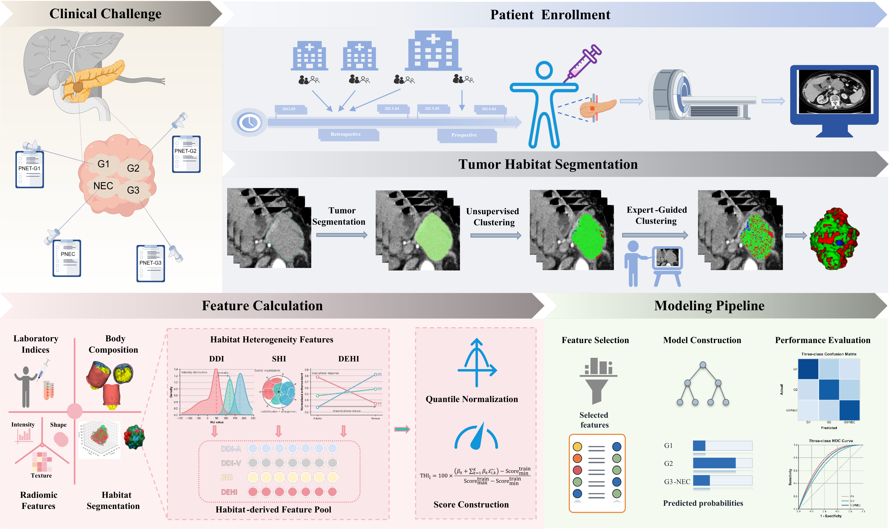

<div align="center">

# PNEN-THI

**Dual-phase CT habitats for preoperative three-tier grading**

Expert-initialized habitats · Interpretable heterogeneity · Frozen inference

[English](README.md) &nbsp; · &nbsp; [简体中文](README_zh.md)

[Quick start](#quick-start) &nbsp; / &nbsp; [Input data](#input-data) &nbsp; / &nbsp; [Core method](#core-method) &nbsp; / &nbsp; [Image scores](#image-scores) &nbsp; / &nbsp; [Grading](#grading) &nbsp; / &nbsp; [Training](#training)

</div>

<a href="assets/study_workflow.png"></a>

**Study workflow.** The PNET-ITH method connects arterial- and venous-phase CT, three tumor habitats, heterogeneity descriptors, and grading models for pancreatic neuroendocrine neoplasms. This repository provides the core numerical method, selected frozen estimators, and one real deidentified image case.

## Overview

PNEN-THI packages the PNET-ITH implementation around two entry points: **`predict.py` for inference** and **`train.py` for refitting the fixed specification**. Image handling, expert-prior learning, habitat clustering, and feature extraction live together in `preprocessing/`.

| Stage | Input | Output |
| :--- | :--- | :--- |
| Expert prior | Training CT, tumor ROI, sparse expert points | Three aggregate arterial-feature centroids |
| Habitats | Registered dual-phase CT, ROI, aggregate prior | Three ordered intratumoral habitats |
| Image scores | Habitat heterogeneity and dual-phase radiomics | THI and RAD, each on a fixed 0–1 scale |
| Grading | Image scores and complete clinical inputs | G1 / G2 / G3/NEC probabilities, risk, and grade |

The supplied case demonstrates the imaging branch. It contains no clinical measurements, outcome, or expert-point annotations. No generated patient inputs or experiment suite is included.

## Setup

Use **Python 3.9** for the full imaging workflow:

```bash
python -m pip install -r preprocessing/requirements-radiomics.txt
```

This includes the base dependencies and the source radiomics environment. Full extraction was verified with Python **3.9.25**, PyRadiomics **3.1.0**, NumPy **1.26.4**, SciPy **1.13.1**, and SimpleITK **2.5.5**. Source estimator loading and training use scikit-learn **1.6.1**.

For THI, model inference from existing features, and fixed-specification training without radiomics extraction:

```bash
python -m pip install -r requirements.txt
```

The base workflow also supports Python 3.12. Run the following commands from the repository root.

## Input data

Organize volumes by phase and annotation, using the same deidentified filename for a case across folders:

```text
data/
├── A/case_001.nii.gz       # arterial CT: the fixed 1-mm reference grid
├── V/                     # original venous CT, before registration
├── V2A/case_001.nii.gz     # venous CT registered and resampled to A
├── ROI/case_001.nii.gz     # segmentation on A; tumor label = 2
└── DOT/                   # sparse expert labels 1/2/3 on A, for prior learning
```

| Folder | Contents | Used by |
| :--- | :--- | :--- |
| `A` | Arterial-phase CT in source HU | Prior learning, clustering, heterogeneity, radiomics |
| `V` | Original venous-phase CT | Upstream registration |
| `V2A` | Venous-phase CT aligned to the arterial grid | Clustering, heterogeneity, radiomics |
| `ROI` | Integer segmentation, 0 background and 2 tumor; optional non-target label 1 | Tumor selection |
| `DOT` | Sparse expert-point labelmap: 0 unannotated and 1/2/3 expert classes | Learning a new aggregate prior |

`V2A` means **V registered to A**. The released real case supplies `A`, `V2A`, and `ROI`; its original `V` and expert `DOT` are not included. New images placed in these folders remain ignored by Git by default.

See the [data and preparation guide](data/README.md) for DICOM conversion, segmentation, registration, point annotation, prior generation, clustering, and feature calculation, with commands for each code stage.

## Quick start

Validate the real example and organize it into the per-case input format:

```bash
python -m preprocessing.prepare --data-root data --case-id case_001 --output-dir outputs/cases/case_001
```

This copies `A → arterial.nii.gz`, `V2A → venous.nii.gz`, and `ROI → tumor_roi.nii.gz`, preserving voxel values and geometry. When a `DOT` file exists, it also copies it to `points.nii.gz`. It requires matching 1-mm grids and refuses existing target files.

Compute habitats, all 18 core heterogeneity features, and THI for the real example:

```bash
python predict.py --thi-only --case outputs/cases/case_001 --output-dir outputs/demo
```

The output directory receives `habitats.nii.gz`, `heterogeneity_features.json`, and `result.json`. With the full radiomics environment, compute the 200 radiomics features and both scores:

```bash
python predict.py --score-only --case outputs/cases/case_001 --output-dir outputs/demo_scores
```

This also writes `radiomics_features.json`, including extraction settings and provenance. Inspect any grading specification with the same entry point:

```bash
python predict.py --list-models
python predict.py --describe model1
python predict.py --describe model7
python predict.py --describe model8
python predict.py --describe model9
```

## Core method

The three steps below expose the complete habitat-to-heterogeneity calculation. Existing registered CT and ROI inputs bypass upstream segmentation and registration. The repository does not include an automatic segmentation model or registration weights.

### 1 · Learn an aggregate expert prior

For a new training dataset, prepare each annotated case as:

```text
your_training_case/
├── arterial.nii.gz
├── tumor_roi.nii.gz
└── points.nii.gz
```

`points.nii.gz` is the prepared copy of `data/DOT/<case_id>.nii.gz`. It contains sparse expert labels **1, 2, 3** on the same grid as the CT and ROI; 0 denotes unannotated voxels. Only points inside the selected tumor ROI contribute. Supply **training cases only**:

```bash
python -m preprocessing.learn_prior --cases /path/to/training_case_001 /path/to/training_case_002 --output outputs/prior.json
```

Arterial HU values are transformed as `clip((HU + 160) / 400, 0, 1)`. At each valid point, the method measures **arterial intensity**, **local standard deviation in a 3 × 3 × 3 neighborhood**, and **3D Sobel gradient magnitude**. Points are pooled across training cases; the coordinatewise median for each expert label defines a centroid. The three centroids are ordered by arterial intensity. The output contains aggregate centroids and annotation counts.

The released 100-case aggregate prior is already embedded in `predict.PRIOR`. Relearning is optional. The supplied demonstration case has no point map and is not an input to prior learning.

### 2 · Construct three constrained habitats

Use the embedded aggregate prior:

```bash
python -m preprocessing.cluster --case outputs/cases/case_001 --output outputs/habitats.nii.gz
```

Or use a prior learned from your own training cases:

```bash
python -m preprocessing.cluster --case outputs/cases/case_001 --prior outputs/prior.json --output outputs/habitats_custom_prior.nii.gz
```

Each tumor voxel has the five-dimensional vector **[A, local SD(A), Sobel(A), V, V − A]**, where A and V use the fixed −160 to 240 HU window mapped to 0–1. Within each case, the arterial block (first three dimensions) and the venous/difference block (last two) are independently median/IQR scaled with `RobustScaler`. Constant columns are removed, and each block is divided by the square root of its retained dimension count.

The expert centroids initialize **only the three arterial dimensions**; other initial coordinates are zero in the scaled space. Constrained K-means uses **K = 3**, a minimum habitat size of **ceil(5% of tumor voxels)**, seed **42**, at most **100** iterations, and relative convergence tolerance **1e−4**. Final labels **1 → 3** follow increasing mean arterial intensity; background is 0.

### 3 · Measure intratumoral heterogeneity

```bash
python -m preprocessing.heterogeneity --case outputs/cases/case_001 --habitats outputs/habitats.nii.gz --output outputs/thi_features.json
```

The calculation returns **18 core features**:

| Family | Count | Measurements |
| :--- | ---: | :--- |
| Distributional heterogeneity, DDI | 9 | Between/within log ratio, centroid separation, Jensen–Shannon divergence, and dispersion diversity for each phase; habitat-balance entropy |
| Spatial heterogeneity, SHI | 4 | Centroid spread, radial Wasserstein distance, interface fraction, and disconnected fraction |
| Dynamic-enhancement heterogeneity, DEHI | 5 | Enhancement-mean spread, Jensen–Shannon divergence, dispersion diversity, phase-correlation diversity, and washout-fraction diversity |

Heterogeneity measurements use the **source HU images**. SHI uses physical coordinates from the NIfTI affine, including voxel volume and equivalent tumor radius. The normalized images used for clustering are not substituted for source HU. `dehi_global_mean` is available with `--include-reference`; it is a reference measurement outside the 18-feature set.

## Image scores

**Dual-phase radiomics.** The released extractor produces **200 features: 14 shared shape + 93 arterial + 93 venous**. It uses PyRadiomics `Original` images, whole-image normalization scaled to **255**, bin width **25**, and **1 × 1 × 1 mm** resampling with B-spline image interpolation. Shape names begin with `original_shape_`; phase-specific names begin with `A_original_` or `V_original_`.

```bash
python -m preprocessing.radiomics --case outputs/cases/case_001 --output outputs/radiomics_features.json
```

Input field of view affects whole-image normalization; retain the intended source preprocessing.

**Locked formulas.** Historical development reduced **18 THI candidates to 7 active features** with ElasticNet (`alpha=0.3`, `l1_ratio=0.2`) and **200 radiomics candidates to 16 active features** (`alpha=0.1`, `l1_ratio=0.5`). The inference coefficients, feature statistics, and scaling constants are held in `predict.SCORES`.

Each raw score is evaluated from its fixed linear formula. It is then transformed as `clip((raw − training_P1) / (training_P99 − training_P1), 0, 1)`. The training P1/P99 values come from the locked-feature, five-fold out-of-fold score construction; future cases use the all-training inference formula with these fixed constants.

<sub>Figure note: the original study graphic retains schematic quantile/min–max labels. The numerical inference contract is the fixed training P1/P99 transformation specified in `SCORES`.</sub>

## Grading

Models 1–9 use **one `predict.py` and a shared weight bundle**. `MODELS` specifies each model's inputs, structure, and grade rule; `CLINICAL` holds the clinical transformations. Models 1–7 are unpenalized proportional-odds logistic models with learned coefficients and two ordered cutpoints. They report three class probabilities and select the most probable grade.

| Model | Clinical inputs | Image scores | Structure / decision |
| :--- | :--- | :--- | :--- |
| Model 1 | size, SFI, TFI, LDH, AST, IFI, RIF% | None | Proportional odds / largest class probability |
| Model 2 | None | RAD | Proportional odds / largest class probability |
| Model 3 | None | THI | Proportional odds / largest class probability |
| Model 4 | size, SFI, TFI, LDH, AST, IFI, RIF% | RAD | Proportional odds / largest class probability |
| Model 5 | size, SFI, TFI, LDH, AST, IFI, RIF% | THI | Proportional odds / largest class probability |
| Model 6 | None | RAD, THI | Proportional odds / largest class probability |
| Model 7 | SFI, TFI, IFI | RAD, THI | Proportional odds / largest class probability |
| Model 8 | LDH, AST, SFI | RAD, THI | RBF-SVC / MLP / polynomial SVM, weights 0.4 / 0.2 / 0.4; largest averaged class probability |
| Model 9 | LDH, AST, SFI, RIF%, size | RAD, THI | Two cumulative binary ensembles; fixed risk thresholds |

Models 1–6 use parameters embedded in `MODELS`. Model 7 uses a bundle generated by `train.py`; Models 8 and 9 use the supplied `weights.joblib`.

```bash
python predict.py --model model1 --input /path/to/clinical_only.json
python predict.py --model model2 --input /path/to/rad_features_or_score.json
python predict.py --model model3 --input /path/to/thi_features_or_score.json
python predict.py --model model7 --input /path/to/measured_features_or_scores.json --clinical /path/to/clinical.json --weights model7.joblib
```

For any refitted model, pass the new shared bundle with `--weights`:

```bash
python predict.py --model model6 --input /path/to/measured_features_or_scores.json --weights models1_7.joblib
```

Change `--model` to `model4`, `model5`, or `model6` to use those fitted specifications. The selected model alone determines the required inputs: Model 1 needs no images or image scores, Model 2 needs no THI or clinical data, and Model 3 needs no RAD or clinical data. For Models 8 and 9:

```bash
python predict.py --model model8 --input /path/to/measured_features_or_scores.json --clinical /path/to/clinical.json --weights weights.joblib
python predict.py --model model9 --input /path/to/measured_features_or_scores.json --clinical /path/to/clinical.json --weights weights.joblib
```

The input JSON contains a `features` object mapping exact feature names to measurements, or a `scores` object containing the required `THI` and/or `RAD` on the clipped 0–1 scale. The clinical JSON maps required clinical names to their raw observed values; the same values may instead be supplied in the input JSON's `clinical` object. A Model 1 input needs only this `clinical` object.

`--case` can replace `--input` for image-based models. Models 2, 3, and 6 need no `--clinical`; Models 3 and 5 compute THI without extracting radiomics:

```bash
python predict.py --model model3 --case outputs/cases/case_001 --output-dir outputs/model3
```

Model 9 repairs crossed cumulative probabilities by averaging them before constructing the three class probabilities. Its lower and upper risk thresholds are **0.6772685594841208** and **0.9673987735976841**; equality selects the higher category.

SFI, TFI and IFI are volume/height³ indices (cm³/m³); `RIF% = 100 × IFI / TFI`, and size is in mm. Use clinical measurements on the original study scale. The required variables undergo their specified `log1p` and training mean/SD transformation. Historical fitted MICE objects are unavailable, so the release requires **complete clinical inputs** for models that use clinical variables. The example case supplies no clinical measurements.

## Training

Select one model, several models, or all nine from the same training entry. Fit Models 1–7 together, including the image-score formulas needed by the selected models:

```bash
python train.py --input /path/to/training_features.csv --models model1 model2 model3 model4 model5 model6 model7 --fit-scores --output models1_7.joblib
```

For a single model, include only its required clinical and image-feature columns. Model 1 uses a clinical table and does not require `--fit-scores`; Models 2 and 3 fit only their respective score:

```bash
python train.py --input /path/to/clinical_training.csv --models model1 --output model1.joblib
python train.py --input /path/to/rad_training.csv --models model2 --fit-scores --output model2.joblib
python train.py --input /path/to/thi_training.csv --models model3 --fit-scores --output model3.joblib
python train.py --input /path/to/training_features.csv --models model7 --fit-scores --output model7.joblib
```

Fit all nine configurations into one bundle, or retain the default Model 8:

```bash
python train.py --input /path/to/training_features.csv --models all --fit-scores --output newly_trained.joblib
python train.py --input /path/to/training_features.csv --fit-scores --output model8.joblib
```

| Training option | Default | Meaning |
| :--- | :--- | :--- |
| `--input` | Required | CSV containing clinical measurements and/or image features or OOF scores |
| `--output` | Required | One new `.joblib` bundle; existing files are not overwritten |
| `--models` | `model8` | One or more of `model1`–`model9`, or `all` |
| `--fit-scores` | Off | Refit only the THI/RAD formulas required by the selected models |
| `--cohort-column` | `Cohort` | Column identifying the data partition |
| `--training-label` | `training` | Only rows with this cohort label are fitted |
| `--grade-column` | `Grade_ordinal` | Ordinal outcome column, encoded 0 / 1 / 2 |

```bash
python train.py --help
```

| CSV columns | Requirement |
| :--- | :--- |
| `Cohort` | Only rows equal to `training` contribute to fitting |
| `Grade_ordinal` | 0 = G1, 1 = G2, 2 = G3/NEC |
| Clinical columns | Complete raw measurements of the variables listed for the selected models above |
| Seven THI and/or sixteen RAD features | With `--fit-scores`, exact raw feature names in `SCORES[name]['terms']` for the required scores only |
| THI/RAD score and source columns | Without `--fit-scores`, normalized OOF scores for the required scores only; see below |

All selected grading models require all three grades in the training rows. When fitting image scores, five-fold stratification requires at least **five training cases per grade**. Missing entries within observed image-feature columns use training-fold medians; entirely unobserved or constant features are discarded. Required clinical measurements must be complete. Model 1 does not require image features or score-source columns.

**Score fitting.** The script refits the locked 7/16-feature sets with five-fold `StratifiedKFold` (`shuffle=True`, seed **20260720**). Each fold learns median imputation, variance filtering, population-SD standardization, and ElasticNet using its training partition only. Score orientation follows training Spearman correlation to ordered grade; centering/scaling is learned in the same partition. Training OOF scores define P1/P99. A final formula is fitted on all training rows for future cases.

**Grading fitting.** Models 1–7 maximize the unpenalized proportional-odds likelihood using SciPy L-BFGS-B (`maxiter=2000`, `ftol=1e−11`, `gtol=1e−7`). Each fit learns the selected feature coefficients and two ordered cutpoints; Model 7 uses the final input order **[SFI, TFI, IFI, RAD, THI]**. Models 8 and 9 refit their fixed components while retaining their ensemble weights and grade rules. Clinical means/SDs are learned from training rows only, with transformation choices fixed. All selected models, fitted clinical transforms, and required score formulas are saved in **one bundle**, and `predict.py --weights` uses those fitted values. The script performs no feature-selection search or performance experiments.

Without `--fit-scores`, supply the required `THI` and/or `RAD` (or `THI_score_01`/`RAD_score_01`) plus corresponding `THI_score_source`/`RAD_score_source` columns. Accepted provenance labels are `out_of_fold`, `nested_oof`, or the original `training_locked_7_feature_5fold_OOF_refit` / `training_locked_16_feature_5fold_OOF_refit`. That path assumes the supplied scores match the published inference formulas and scaling; use `--fit-scores` to keep new-dataset formulas and scores together.

The public training entry refits the selected specifications. Historical clinical screening and posterior MICE imputation are not recreated. The fixed selected features and shared OOF scaling do not provide a nested feature-selection evaluation or a new performance claim.

<details>
<summary><b>Historical model-development procedure</b></summary>

Clinical screening used the training cohort: exclude variables with at least 25% missingness, log1p-transform skewed nonnegative variables, screen univariable proportional-odds likelihood-ratio tests at BH-FDR q&lt;0.10, and prune redundancy at |Spearman rho|≥0.85. Five training-fitted Bayesian-Ridge chained-equation imputations with posterior sampling were averaged, preserving observed values; validation outcomes were excluded. The saved imputation estimators are unavailable, which is why the public entry requires complete clinical inputs. Score regularization was compared within training cross-validation. Nonlinear families, feature subsets, hyperparameters and ensemble weights for Model 8 were selected using internal tuning. The released `train.py` refits the resulting locked specifications, rather than rerunning those selection searches.

</details>

## Repository layout

```text
PNEN-THI/
├── README.md
├── README_zh.md
├── predict.py                 # MODELS · SCORES · CLINICAL · PRIOR; all inference
├── train.py                   # one fixed-specification refitting entry
├── weights.joblib             # selected fitted states in one shared bundle
├── requirements.txt
├── preprocessing/
│   ├── io.py                  # NIfTI geometry and source-HU handling
│   ├── prepare.py             # validate A / V2A / ROI / optional DOT; organize a case
│   ├── learn_prior.py         # step 1: aggregate expert-point centroids
│   ├── cluster.py             # step 2: constrained three-habitat clustering
│   ├── heterogeneity.py       # step 3: 18 DDI / SHI / DEHI features
│   ├── radiomics.py           # 200 Original dual-phase features
│   └── requirements-radiomics.txt
├── assets/
│   └── study_workflow.png
└── data/
    ├── README.md / README_zh.md # preparation and complete workflow guides
    ├── A/case_001.nii.gz
    ├── V/
    ├── V2A/case_001.nii.gz
    ├── ROI/case_001.nii.gz
    ├── DOT/
    └── case_001.json
```

The example preserves voxel values and spatial geometry with neutral filenames and cleaned NIfTI headers. **Tumor label is 2**; the ROI also contains non-target label 1. Inputs must share a **1-mm isotropic grid**, shape and affine, with anatomical alignment checked before inference. A matching grid alone does not establish registration.

The shared weight file excludes cohort tables and research-run outputs. Fitted SVCs still contain support vectors, and kNN retains its reference vectors/classes as part of the estimator state. Private migration checks against the source model implementations agreed to an absolute error of **≤1e−12**; this verifies inference migration, without estimating performance from the released example.

## Use and citation

For **academic and non-commercial research** use. Please contact the authors for clinical or commercial licensing.

Until formal manuscript citation metadata are provided, reference the [PNEN-THI repository](https://github.com/BobbyWang16/PNEN-THI). The manuscript and full research cohort are not included in this release.
