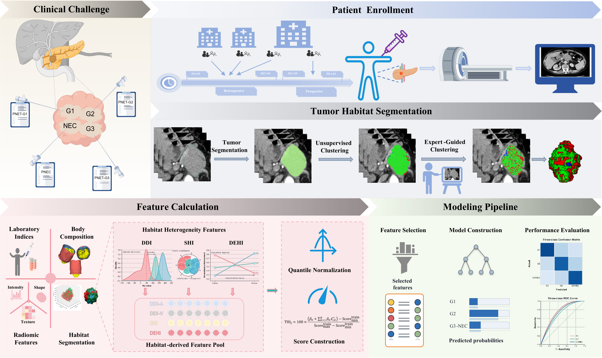

<div align="center">

# PNEN-THI

**Dual-phase CT habitats for a tumor heterogeneity index and preoperative three-tier grading**

[English](README.md) · [简体中文](README_zh.md)

</div>



Construct three tumor habitats from arterial- and venous-phase CT, calculate the **tumor heterogeneity index (THI)**, and support **G1 / G2 / G3/NEC** grading of pancreatic neuroendocrine neoplasms. The repository includes feature extraction, fixed-model inference and refitting scripts, a learned prior, fitted model weights, and one real deidentified imaging case.

## Setup

Use **Python 3.9** and run all commands from the repository root:

```bash
python -m pip install -r requirements.txt
```

## Quick start

Prepare the supplied case, then calculate three habitats, 18 heterogeneity features, and THI:

```bash
python -m preprocessing.prepare --data-root data --case-id case_001 --output-dir outputs/cases/case_001
python predict.py --thi-only --case outputs/cases/case_001 --output-dir outputs/demo
```

Outputs are `habitats.nii.gz`, `heterogeneity_features.json`, and `result.json`. The released `point_prior_n100.pkl` is used by default; no expert-point annotations or retraining are needed. Preparation does not overwrite existing files; choose a new case output directory when repeating it.

To calculate both THI and the radiomics score RAD:

```bash
python predict.py --score-only --case outputs/cases/case_001 --output-dir outputs/demo_scores
```

This also saves `radiomics_features.json`. All feature JSON files use `{"features": {"feature_name": value}}` and can be passed directly to `--input` for the corresponding model.

## Input data

Use the same case filename across folders:

```text
data/
├── A/case_001.nii.gz       # arterial CT in source HU
├── V2A/case_001.nii.gz     # venous CT registered and resampled to A
├── ROI/case_001.nii.gz     # labels on A: 2 = tumor, 0 = background
└── DOT/                   # optional expert points: 0 unmarked, 1/2/3 perfusion phenotypes
```

`A`, `V2A`, and `ROI` must share a **1-mm isotropic grid, shape, and affine**, with anatomical registration checked. Other ROI labels are excluded. The supplied case is ready for image analysis and has no clinical measurements, pathological outcome, or expert points.

`prepare` only validates and copies inputs; it does not segment or register images. Original venous images may be stored in `V/`; analysis requires `V2A/`. See the [data preparation guide](data/README.md) for preprocessing, registration, and annotation.

## Core method

1. **Learn a prior.** Normalize arterial HU with `clip((HU + 160) / 400, 0, 1)`. At training expert points, extract intensity, 3 × 3 × 3 local SD, and 3D Sobel magnitude. Class-wise coordinate medians define three centers. The released prior summarizes **3,390 expert points from 100 training cases**.
2. **Construct habitats.** Each tumor voxel uses `[A, local SD(A), Sobel(A), V, V − A]`. The first three and last two dimensions are separately median/IQR-scaled within each case, stripped of constant columns, and divided by the square root of each block's retained dimension. The prior initializes only the arterial dimensions. Constrained K-means uses **K = 3, at least 5% per habitat**, seed 42, and at most 100 iterations. Labels 1/2/3 follow increasing mean normalized arterial intensity.
3. **Measure heterogeneity.** Calculate **9 distribution (DDI), 4 spatial (SHI), and 5 dynamic enhancement (DEHI) features** from source HU, using affine-defined physical coordinates for spatial measurements.

Run individual steps with:

```bash
python -m preprocessing.cluster --case outputs/cases/case_001 --output outputs/habitats.nii.gz
python -m preprocessing.heterogeneity --case outputs/cases/case_001 --habitats outputs/habitats.nii.gz --output outputs/thi_features.json
```

Only to learn a new prior from your own training cases:

```bash
python -m preprocessing.learn_prior --cases /path/to/training_case_001 /path/to/training_case_002 --output outputs/point_prior.pkl
```

Each training directory needs `arterial.nii.gz`, `tumor_roi.nii.gz`, and `points.nii.gz`; valid points must collectively cover all three classes. Pass the new prior with `--prior outputs/point_prior.pkl` to clustering or image inference using THI. Load `.pkl` and `.joblib` files only from trusted sources.

## Image scores

**THI** uses **7 of the 18** heterogeneity candidates; **RAD** uses **16 of 200** radiomics candidates. Exact feature names and fixed linear coefficients are in [`predict.SCORES`](predict.py). Both scores use training five-fold out-of-fold P1/P99 scaling: `clip((raw − P1) / (P99 − P1), 0, 1)`.

Dual-phase radiomics uses **PyRadiomics 3.1.0**: 14 shared shape features plus 93 nonshape features per phase. Settings are `Original` images, whole-image normalization scaled to 255, bin width 25, 1-mm resampling, and B-spline interpolation. Whole-image normalization depends on the field of view; follow the cropping procedure in the data guide.

```bash
python -m preprocessing.radiomics --case outputs/cases/case_001 --output outputs/radiomics_features.json
```

## Grading

| Model | Clinical inputs | Image scores | Method |
| :--- | :--- | :--- | :--- |
| Model 1 | size, SFI, TFI, LDH, AST, IFI, RIF% | None | Proportional-odds logistic |
| Model 2 | None | RAD | Proportional-odds logistic |
| Model 3 | None | THI | Proportional-odds logistic |
| Model 4 | Same as Model 1 | RAD | Proportional-odds logistic |
| Model 5 | Same as Model 1 | THI | Proportional-odds logistic |
| Model 6 | None | RAD, THI | Proportional-odds logistic |
| Model 7 | SFI, TFI, IFI | RAD, THI | Proportional-odds logistic |
| Model 8 | LDH, AST, SFI | RAD, THI | RBF-SVC / MLP / polynomial SVM, weights 0.4 / 0.2 / 0.4 |
| Model 9 | LDH, AST, SFI, RIF%, size | RAD, THI | Two cumulative binary ensembles, fixed risk thresholds |

Models 1–6 use inline parameters; Models 8 and 9 use the supplied `weights.joblib`. Train Model 7 with `train.py` before use. Models 1–8 select the highest class probability; Model 9 applies risk thresholds. Use `--list-models` or `--describe model9` for the specifications.

```bash
python predict.py --model model3 --input outputs/demo/heterogeneity_features.json
python predict.py --model model8 --case outputs/cases/case_001 --clinical /path/to/clinical.json --weights weights.joblib
```

Clinical models need the listed raw measurements, supplied as a separate JSON via `--clinical` or in the input JSON's `clinical` object. Size is in mm; SFI, TFI, and IFI are in cm³/m³; `RIF% = 100 × IFI / TFI`. The code applies the prescribed clinical transforms.

Precomputed scores may be supplied as `{"scores": {"THI": 0.5, "RAD": 0.4}}`, providing the numeric 0–1 values required by the model. Do not pass the nested `raw/scaled` score objects from `result.json` directly. Use `--weights` to load refitted models, clinical transforms, and score formulas.

## Training

For example, refit the THI-only Model 3:

```bash
python train.py --input /path/to/training_features.csv --models model3 --fit-scores --output model3.joblib
python predict.py --model model3 --input outputs/demo/heterogeneity_features.json --weights model3.joblib
```

- `--models` accepts one name, several names, or `all`; the default is `model8`.
- By default, CSV rows with `Cohort=training` are fitted. `Grade_ordinal` is 0/1/2 for G1/G2/G3/NEC.
- Supply the selected model's clinical columns. With `--fit-scores`, also supply its raw feature columns from `SCORES[name]['terms']` and at least five cases per grade. Training must include all three grades.
- `--fit-scores` performs five-fold fitting on the fixed feature sets, seed 20260720. THI / RAD ElasticNet `(alpha, l1_ratio)` values are `(0.3, 0.2)` / `(0.1, 0.5)`. Out-of-fold scores define P1/P99; all-training formulas are used for inference.
- Without `--fit-scores`, supply the required numeric 0–1 out-of-fold columns `THI` / `RAD` (or `THI_score_01` / `RAD_score_01`), with `THI_score_source` / `RAD_score_source` set to `out_of_fold` or `nested_oof`. Scores must match the published formulas and scaling.

Training writes a new `.joblib` bundle without overwriting existing files. `train.py` refits fixed specifications; it does not repeat model selection or performance evaluation. See `python train.py --help` for further options.

## Use and citation

For **academic and non-commercial research** use; contact the authors for clinical or commercial licensing. Until manuscript citation details are available, cite the [PNEN-THI repository](https://github.com/BobbyWang16/PNEN-THI).
