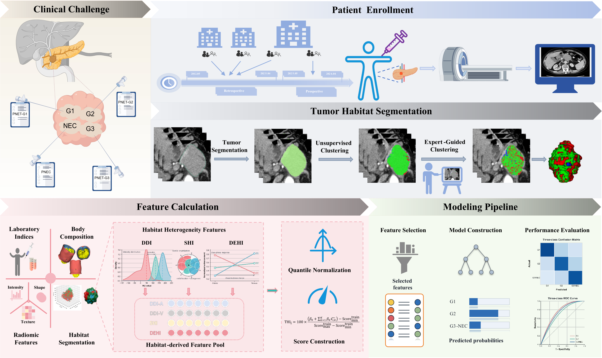

<div align="center">

# PNEN-THI

**基于双期 CT 生境的肿瘤异质性指数与术前三分类分级**

[English](README.md) · [简体中文](README_zh.md)

</div>



从动脉期和静脉期 CT 构建三类肿瘤生境，计算肿瘤异质性指数 **THI**，并支持胰腺神经内分泌肿瘤的 **G1 / G2 / G3/NEC** 分级。仓库提供特征提取、固定模型推理和重新训练脚本，以及已学习先验、模型权重和一例去标识真实影像。

## 环境配置

使用 **Python 3.9**，以下命令均在仓库根目录运行：

```bash
python -m pip install -r requirements.txt
```

## 快速开始

整理所附病例，计算三类生境、18 项异质性特征和 THI：

```bash
python -m preprocessing.prepare --data-root data --case-id case_001 --output-dir outputs/cases/case_001
python predict.py --thi-only --case outputs/cases/case_001 --output-dir outputs/demo
```

输出为 `habitats.nii.gz`、`heterogeneity_features.json` 和 `result.json`。默认使用 `point_prior_n100.pkl`，无需专家点标注或重新训练；整理脚本不覆盖已有文件，重复运行时请换一个病例输出目录。

同时计算 THI 和影像组学评分 RAD：

```bash
python predict.py --score-only --case outputs/cases/case_001 --output-dir outputs/demo_scores
```

该命令还会输出 `radiomics_features.json`。所有特征 JSON 统一为 `{"features": {"特征名": 数值}}`，可直接作为对应模型的 `--input`。

## 输入数据

同一病例在各目录使用相同文件名：

```text
data/
├── A/case_001.nii.gz       # 动脉期 CT，保留原始 HU
├── V2A/case_001.nii.gz     # 配准并重采样到动脉期的静脉期 CT
├── ROI/case_001.nii.gz     # A 网格上的标签图：2 为肿瘤，0 为背景
└── DOT/                   # 可选专家点：0 未标注，1/2/3 为三类灌注表型
```

`A、V2A、ROI` 必须具有一致的 **1 mm 各向同性网格、尺寸和 affine**，并确认解剖配准。ROI 中其他标签不参与计算。所附病例已完成影像准备，不含临床测量、病理结局或专家点。

`prepare` 仅校验并复制输入，不执行分割或配准。原始静脉期可存于 `V/`；最终分析必须使用 `V2A/`。完整预处理、配准和标注方法见[数据准备指南](data/README_zh.md)。

## 核心方法

1. **学习先验。** 动脉期按 `clip((HU + 160) / 400, 0, 1)` 归一化，在训练集专家点提取强度、3 × 3 × 3 局部标准差和 3D Sobel 梯度幅值。按类别取逐坐标中位数，形成三个中心。发布先验来自 **100 例训练病例、3,390 个专家点**。
2. **构建生境。** 肿瘤体素向量为 `[A, local SD(A), Sobel(A), V, V − A]`。前三维与后两维分别在病例内进行中位数/IQR 缩放、移除常量列，并除以各块保留维数的平方根。先验仅初始化动脉维度；受约束 K-means 固定 **K = 3，每类至少占 5%**，种子 42，最多 100 次迭代。输出标签 1/2/3 按归一化动脉平均强度递增排列。
3. **提取异质性特征。** 使用原始 HU 计算 **9 项分布异质性 DDI、4 项空间异质性 SHI、5 项动态强化异质性 DEHI**；空间测量使用 affine 定义的物理坐标。

各步骤可独立运行：

```bash
python -m preprocessing.cluster --case outputs/cases/case_001 --output outputs/habitats.nii.gz
python -m preprocessing.heterogeneity --case outputs/cases/case_001 --habitats outputs/habitats.nii.gz --output outputs/thi_features.json
```

仅在用自己的训练病例学习新先验时运行：

```bash
python -m preprocessing.learn_prior --cases /path/to/training_case_001 /path/to/training_case_002 --output outputs/point_prior.pkl
```

训练目录需提供 `arterial.nii.gz`、`tumor_roi.nii.gz` 和 `points.nii.gz`，有效专家点合计覆盖三类。随后通过 `--prior outputs/point_prior.pkl` 将新先验传给聚类或使用 THI 的影像推理命令。仅加载可信来源的 `.pkl` 和 `.joblib` 文件。

## 影像评分

**THI** 使用 18 项异质性候选特征中的 **7 项**；**RAD** 使用 200 项组学候选特征中的 **16 项**。特征名和固定线性系数见 [`predict.SCORES`](predict.py)。两者均按训练集五折折外评分的 P1/P99 映射到 0–1：`clip((raw − P1) / (P99 − P1), 0, 1)`。

双期组学使用 **PyRadiomics 3.1.0**：14 项共享形状特征 + 两期各 93 项非形状特征。采用 `Original` 影像、整幅归一化并缩放至 255、灰度箱宽 25、1 mm 重采样和 B-spline 插值。整幅归一化受视野影响，需保持数据指南规定的裁剪方式。

```bash
python -m preprocessing.radiomics --case outputs/cases/case_001 --output outputs/radiomics_features.json
```

## 分级推理

| 模型 | 临床输入 | 影像评分 | 方法 |
| :--- | :--- | :--- | :--- |
| Model 1 | size、SFI、TFI、LDH、AST、IFI、RIF% | 无 | 比例优势 Logistic |
| Model 2 | 无 | RAD | 比例优势 Logistic |
| Model 3 | 无 | THI | 比例优势 Logistic |
| Model 4 | 同 Model 1 | RAD | 比例优势 Logistic |
| Model 5 | 同 Model 1 | THI | 比例优势 Logistic |
| Model 6 | 无 | RAD、THI | 比例优势 Logistic |
| Model 7 | SFI、TFI、IFI | RAD、THI | 比例优势 Logistic |
| Model 8 | LDH、AST、SFI | RAD、THI | RBF-SVC / MLP / 多项式 SVM，权重 0.4 / 0.2 / 0.4 |
| Model 9 | LDH、AST、SFI、RIF%、size | RAD、THI | 两个累积二分类集成，固定风险阈值 |

Model 1–6 使用内置参数，Model 8、9 使用所附 `weights.joblib`；Model 7 先用 `train.py` 生成权重。Model 1–8 取最大类别概率，Model 9 按风险阈值分级。用 `--list-models` 或 `--describe model9` 查看具体规格。

```bash
python predict.py --model model3 --input outputs/demo/heterogeneity_features.json
python predict.py --model model8 --case outputs/cases/case_001 --clinical /path/to/clinical.json --weights weights.joblib
```

临床模型需提供表中所需的原始实测值：可通过 `--clinical` 传入独立 JSON，或放入输入 JSON 的 `clinical` 对象。size 单位为 mm；SFI、TFI、IFI 为 cm³/m³；`RIF% = 100 × IFI / TFI`。代码自动执行既定临床变换。

已有评分可用 `{"scores": {"THI": 0.5, "RAD": 0.4}}` 输入，按模型提供所需的 0–1 数值；不要直接传入 `result.json` 中含 `raw/scaled` 的嵌套评分对象。使用 `--weights` 可加载重新训练的模型、临床变换和评分公式。

## 训练

例如，重新拟合仅使用 THI 的 Model 3：

```bash
python train.py --input /path/to/training_features.csv --models model3 --fit-scores --output model3.joblib
python predict.py --model model3 --input outputs/demo/heterogeneity_features.json --weights model3.joblib
```

- `--models` 支持单个名称、多个名称或 `all`；默认 `model8`。
- CSV 默认用 `Cohort=training` 选择训练行，`Grade_ordinal` 编码为 0/1/2，对应 G1/G2/G3/NEC。
- 提供所选模型需要的临床列；使用 `--fit-scores` 时，另需 `SCORES[name]['terms']` 中对应的原始特征列，且每个等级至少 5 例。训练行必须覆盖全部三个等级。
- `--fit-scores` 在固定特征集上进行五折折外拟合，种子 20260720；THI / RAD 的 ElasticNet `(alpha, l1_ratio)` 分别为 `(0.3, 0.2)` / `(0.1, 0.5)`。折外评分确定 P1/P99，全训练集公式用于后续推理。
- 不使用 `--fit-scores` 时，提供所需的 0–1 折外评分列 `THI` / `RAD`（或 `THI_score_01` / `RAD_score_01`），并以 `THI_score_source` / `RAD_score_source` 标注 `out_of_fold` 或 `nested_oof`；评分必须匹配发布的公式与缩放。

输出为一个新的 `.joblib` 权重包，不覆盖已有文件。`train.py` 重新拟合固定规格，不重复模型选择或性能评估；更多参数见 `python train.py --help`。

## 使用与引用

仅供**学术及非商业研究**使用；临床或商业授权请联系作者。正式稿件引用信息提供前，请引用 [PNEN-THI 仓库](https://github.com/BobbyWang16/PNEN-THI)。
